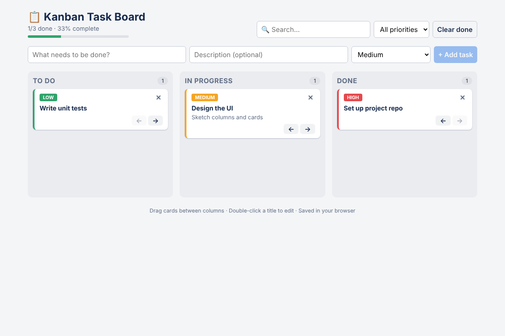

# 📋 Kanban Task Board

A Trello-style task board built with **React 18** and **Vite**. Drag tasks between columns, set priorities, search and filter, with everything saved in the browser automatically.

  

**🔗 Live demo:** `https://<your-username>.github.io/kanban-task-board/` *(goes live after you enable GitHub Pages, see below)*



## ✨ Features

- **Drag & drop** cards between *To Do → In Progress → Done* (native HTML5 drag & drop API, no library)
- **Reorder** by dropping a card on top of another card
- **Keyboard-friendly** ← → buttons as an alternative to dragging
- **Priorities** (low / medium / high) with colour coding
- **Inline edit**: double-click a title, Enter to save, Esc to cancel
- **Search + priority filter**
- **Progress bar** showing % of tasks done
- **Auto-save** to `localStorage` via a custom hook, so tasks survive refresh
- **Responsive**: columns stack on mobile
- **Unit tests** with Vitest + **CI/CD** to GitHub Pages

## 🏗️ Architecture

```
src/
├── state/
│   ├── boardReducer.js        # ALL state changes live here (pure function)
│   └── boardReducer.test.js   # 7 unit tests
├── hooks/
│   └── useLocalStorageReducer.js  # useReducer + persistence
├── components/
│   ├── TaskForm.jsx    # Controlled form to add tasks
│   ├── Column.jsx      # Drop zone + drag handlers
│   └── TaskCard.jsx    # Card with edit, delete, move
├── App.jsx             # Layout, filters, progress
└── styles.css
```

**Why `useReducer` instead of many `useState`s?** All actions (`ADD_TASK`, `MOVE_TASK`, `DELETE_TASK`…) go through one pure function. That makes state changes predictable and lets me unit-test the logic without rendering any UI. It's the same pattern Redux uses.

**Why a custom hook for storage?** `useLocalStorageReducer` wraps `useReducer` and syncs to `localStorage` in a `useEffect`. Any component could reuse it, and it falls back safely if storage is blocked or the data is corrupted.

## 🚀 Run It Locally

**Needs:** Node.js 18 or newer ([download LTS](https://nodejs.org/)). Works on Windows, Mac and Linux.

```bash
cd kanban-task-board
npm install        # install packages (first time only)
npm run dev        # start dev server → open http://localhost:5173
npm test           # run unit tests
npm run build      # production build into dist/
```

## 🌐 Deploy Free on GitHub Pages

1. Push this repo to GitHub (branch `main`).
2. On GitHub: **Settings → Pages → Build and deployment → Source: GitHub Actions**.
3. Every push now runs tests, builds, and deploys automatically (see `.github/workflows/deploy.yml`).
4. Your app is live at `https://<your-username>.github.io/kanban-task-board/`.

## 🔮 Future Improvements

- Backend sync (e.g. connect to a REST API) so boards work across devices
- Due dates with overdue highlighting
- Custom columns
- Touch drag & drop for mobile (HTML5 DnD doesn't fire on touch screens)

## 📄 License
MIT
